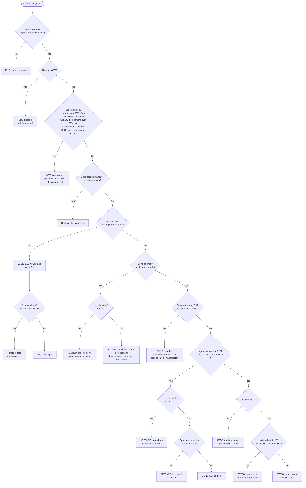

# HW5: Autonomous LEGO Sumo Robot

**Status:** built 2026-10-19; sim tests pass; hardware testing next (see PROGRESS.md).

## Goal
- A LEGO Double Motor robot drives itself inside a ring outlined in blue tape. It tries to push the opponent out and avoid being pushed out itself.
- A front-mounted LEGO Color Sensor is a fast reflex that stops the robot before it fully crosses the blue tape.
- An overhead camera finds the ring, our robot and the opponent.
- A handheld Arduino UNO Q with an MPU-6050 publishes "shake intensity" over MQTT (`ME193/hudson`).
  - More shaking makes the robot more aggressive.
  - No shaking puts it in defense mode.
- Push detection: the robot notices when it's being shoved and fights to stay in the ring.
- `lose.mp3` plays when the robot is detected outside the ring.
- Every decision uses sensor fusion, not a single sensor.

## Decisions (confirmed)
| Question | Answer |
|---|---|
| Ring | circle outlined in blue tape on a dark gray floor (assumed to be the same gray inside and outside) |
| Our robot's tags | two AprilTags: one on the **front**, one on the **back**. `make_tags.py` generates them and records which is which. |
| Opponent | no tag; found by background subtraction |
| Camera | phone through "Windows Virtual Camera", roughly overhead |
| LEGO cards | Double Motor and Color Sensor both on the purple card, serial 5164 |
| MPU-6050 | breakout wired to the UNO Q SDA/SCL pins (`Wire`), 3.3 V |
| Sound | reuse `HW3/lose.mp3` |

## Hardware and data flow

```
 [MPU-6050]--I2C-->[UNO Q sketch]--Bridge-->[UNO Q python]--MQTT "shake:0.72"--+
                                                                               |
 [Overhead camera]--USB/Phone Link--+                                          v
                                    +--> [Laptop: sumo.py] <-- ME193/hudson ---+
 [Double Motor + IMU]<==BLE=========+        |  (fusion + behavior, 20 Hz)
 [Color Sensor]======BLE============+        +--> pygame: lose.mp3
```

## Code reused from earlier assignments
| From | What |
|---|---|
| `HW4/mqttlib.py` | MQTT client wrapper (copied into HW5) |
| `HW3/frequency_drive.py` | DoubleMotor connect, brake end state, pygame mp3 playback, `connect_mqtt` retries |
| `HW3/lose.mp3` | the lose sound (copied into HW5) |
| `HW4/minifig_tracker.py` | `open_camera()` / camera-name hint |
| `Midterm/vision.py`, `HW2/apriltag_detector.py` | AprilTag 36h11 detection |
| `HW4/minifig-car-tracker/` | UNO Q app layout (app.yaml, Bridge, MQTT with reconnect) |
| `Midterm/wii/hub.py` | reading the Double Motor IMU at ~38 Hz |

## File layout (all in `HW5/`)
| File | Purpose |
|---|---|
| `PLAN.md` / `PROGRESS.md` | this plan / dated progress log |
| `make_tags.py` | generates the front and back AprilTags as a printable page and saves `robot_tags.json` |
| `robot_tags.json` | `{family, front_id, back_id, tag_size_cm, front_offset_cm, back_offset_cm}`, read by `vision.py` |
| `tags/` | `front_tag.png`, `back_tag.png`, `robot_tags_print.png` (both on one page at true size) |
| `config.py` | all tunables: card colors and serials, topic, HSV thresholds, gains, timeouts |
| `mqttlib.py` | copy of the HW4 wrapper |
| `robot_io.py` | `Robot` class: connects DoubleMotor and ColorSensor, `tank(l, r)`, `stop()`, IMU and color snapshots, disconnect with timeout |
| `vision.py` | camera thread: ring calibration, AprilTag on our robot, opponent blob detection, outputs in ring coordinates |
| `fusion.py` | pose EKF, opponent tracker, edge-risk estimator, push detector, aggression filter |
| `behavior.py` | priority state machine that turns the fused state into tank speeds |
| `sounds.py` | pygame `lose.mp3` (plays once per loss) |
| `sumo.py` | main entry: starts threads, 20 Hz control loop, debug overlay window, keyboard controls |
| `sim.py` | headless 2D simulator (fake robot, opponent, sensors) to test fusion and behavior without hardware |
| `lose.mp3` | the lose sound |
| `sumo-shake-controller/` | UNO Q App Lab app (unique folder name) |
| `sumo-shake-controller/app.yaml` | app metadata |
| `sumo-shake-controller/sketch/sketch.ino` | reads the MPU-6050 at 200 Hz, computes shake intensity, `Bridge.provide("get_shake")` |
| `sumo-shake-controller/sketch/sketch.yaml` | `arduino:zephyr` profile |
| `sumo-shake-controller/python/main.py` | polls the Bridge at 20 Hz and publishes `shake:<0..1>` on `ME193/hudson` |
| `sumo-shake-controller/python/requirements.txt` | `paho-mqtt>=2.0` |

## 1. Shake controller (UNO Q + MPU-6050)
- **Wiring:** MPU-6050 breakout VCC→3.3V, GND, SDA/SCL to the UNO Q header's SDA/SCL (`Wire`), address 0x68.
- **Sketch:**
  - Wake the chip (`PWR_MGMT_1=0`). Set accel to ±8 g (hard shakes pass 2 g) and gyro to ±1000 °/s. DLPF ~44 Hz.
  - Every 5 ms, read accel and gyro in one burst of 14 bytes.
  - **Fusion of accel and gyro into one shake score:**
    - Gravity estimate `g_est` = slow low-pass of the accel vector. This is a complementary filter: the gyro rotates `g_est` between samples so rotating the controller isn't counted as shaking.
    - Dynamic accel = `|a - g_est|`. Rotational shake = `|gyro|`.
    - `raw = w_a * rms(dynamic accel, 0.4 s) + w_g * rms(gyro, 0.4 s)`.
    - Envelope follower: fast attack (~0.1 s), slow release (~1.0 s), so the robot doesn't flip modes between shakes.
    - Normalize to 0..1 using a `SHAKE_MAX` constant tuned by hand.
  - `get_shake()` returns `"intensity,ax,ay,az,gx,gy,gz"`; the raw values are for debugging.
  - The sketch sets a fault flag if the MPU stops responding (I2C error).
- **Python on the board:**
  - Polls `get_shake` at 20 Hz.
  - Publishes `shake:0.63` on `ME193/hudson`. Publishes `shake:err` if the sensor faults.
  - Uses paho `connect_async` + `loop_start`, the same pattern as HW4.

## 2. Laptop: robot I/O (`robot_io.py`)
- **Double Motor:**
  - `movement_move_tank(speed_left, speed_right, blocking=False)`, with speeds clamped to ±100 and the BRAKE end state.
  - Commands go out only when they change by more than 3, or every 0.25 s, so BLE isn't flooded.
- **IMU:**
  - Read with `device_notification_delay=15` for ~38 Hz.
  - Gives yaw (tenths of a degree), gyro z rate, and accel x/y (forward/lateral in the robot frame; the axis mapping is checked on day one).
- **Color sensor:**
  - Gives `hue`, `saturation`, `value` and `reflection`.
  - `classify()` returns `BLUE` (tape) or `GRAY` (floor). It uses nearest-centroid matching in HSV, with centroids recorded during a calibration step (key `k` captures each one).

## 3. Vision (`vision.py`, runs on its own thread)
- **Ring calibration** (key `c`, with an empty ring):
  - HSV mask for blue, then morphology, then the largest contour, then `fitEllipse`.
  - Build a homography from the ellipse to **ring coordinates**: ring center (0,0) and tape radius 1.0. This also corrects for a camera that isn't directly overhead.
  - Save a snapshot of the empty ring as the background for opponent detection.
  - Save everything to `ring_calibration.json`.
- **Tag generator (`make_tags.py`):**
  - Run once: `python HW5/make_tags.py --front 1 --back 2 --size-cm 5`.
  - Uses `cv2.aruco.generateImageMarker` (36h11) to write each tag with a white border and a large "FRONT" or "BACK" label under it.
  - Writes a print page at 300 dpi, so the tags print at the real size given.
  - Saves `robot_tags.json`. It asks for (or takes as flags) how far each tag sits from the robot's center along its length; the defaults are measured on day one.
- **Camera on a chair (side view):**
  - After `c`, put the robot in the ring and press `p`. Do it at 2-3 spots toward the edge.
  - The tags (squares of one size) plus the tape (a circle) give the full perspective floor map and the camera's position (`perspective.py`).
  - The tags (8 cm up) and the opponent's body are corrected for their height above the floor.
  - See PROGRESS.md, 2026-10-19.
- **Our robot (two tags):**
  - Detect both IDs from `robot_tags.json` and map their centers into ring coordinates.
  - **Both tags seen:** heading = direction from the back tag to the front tag; center = the point between them, placed using the saved offsets. This is more accurate than one tag's own orientation.
  - **One tag seen** (the other hidden by the opponent): position and heading come from that tag's corners, shifted by its known offset to the center. Confidence is lower.
  - **Neither tag seen:** the EKF dead-reckons (see 4a).
  - The tag geometry also tells us which end of the robot is touching the opponent, which helps the push detector.
- **Opponent:**
  - Background subtraction against the empty-ring snapshot, keeping only pixels inside the ring.
  - Subtract our robot's blob, which we know from the tag.
  - The largest remaining blob is the opponent: centroid plus approximate radius.
  - If the opponent also has a tag, use it instead.
- **Out-of-ring check:** each frame reports how much of each robot's blob is past r = 1.0.
- Every measurement carries a timestamp, so fusion can account for camera latency.

## 4. Sensor fusion (`fusion.py`)

**4a. Our pose: EKF, state `[x, y, θ, v]`**
- **Predict** at 20 Hz:
  - `v` comes from the commanded tank speeds times a calibrated gain (ring units/s per speed unit).
  - The turn rate `ω` comes from the **IMU gyro**, not the command, because the gyro is more accurate.
  - Forward accel from the IMU nudges `v`.
- **Update** with camera AprilTag `(x, y, θ)`:
  - Noise is scaled by tag confidence.
  - Late frames are handled by rolling the prediction forward from the frame's timestamp.
- **Heading:** IMU yaw is a second θ measurement, with an estimated yaw offset state, so gyro drift is corrected by the camera.
- **Camera dropouts:** if the tag is hidden (opponent on top, glare), the EKF keeps going on IMU and command dead reckoning, and its uncertainty grows. Behavior turns more cautious when uncertainty is high.

**4b. Opponent tracker:** a constant-velocity Kalman filter on the camera blob gives opponent position, velocity, and closing speed toward us.

**4c. Edge risk (0..1)** combines:
- distance to the edge from the fused pose: `1 - r`, with uncertainty included;
- time-to-edge: `(1 - r) / outward radial speed`;
- the color sensor: `BLUE` → risk = 1 immediately; it's the fastest sensor and isn't affected by camera lag;
- color history: `BLUE` followed by gray while moving outward (from the fused heading) means the nose has crossed the tape. The floor is the same gray on both sides, so the sensor can't tell inside from outside by color alone; the fused heading and position decide which side the robot is on.

**4d. Push detector:** a weighted log-odds sum of these cues, with hysteresis, outputs `push_prob` and an estimated `push_dir`:
1. **Motion residual:** camera-observed displacement minus the displacement our commands predict (EKF innovation). A sustained residual means an outside force; its direction gives `push_dir`.
2. **IMU accel:** forward/lateral accel that disagrees with the commanded accel, such as a sharp backward spike while driving forward.
3. **Yaw residual:** gyro yaw rate minus commanded turn rate, which catches being spun.
4. **Contact:** opponent within its own radius plus ours (from the camera), with closing speed > 0.
5. **Stall:** commanded speed is high but the fused speed is about 0, meaning we're in a shoving match. Motor position feedback is added if the Double Motor reports it.

**4e. Aggression:**
- MQTT `shake:x` goes through an EMA filter.
- If no message arrives for 2 s, aggression decays to 0, which means defense. Losing the controller should never make the robot charge blindly.

**4f. Lose detection** (any two of these, or the camera alone for 0.5 s):
- the camera shows more than 60% of our blob outside r = 1.0;
- the fused pose has r > 1.1;
- the color sensor crossed `BLUE` → gray while the fused pose says it was moving outward.

On a loss: stop the motors, play `lose.mp3` once, publish `sumo:lost`, and freeze until `r` (reset).

## 5. Behavior (`behavior.py`): priority arbitration at 20 Hz
| Priority | State | Trigger | Action |
|---|---|---|---|
| 1 | `LOST` | lose detection (4f) | stop, sound, wait for reset |
| 2 | `EDGE_ESCAPE` | color = BLUE, or edge risk > 0.8 | brake, reverse ~0.4 s, then rotate toward the ring center using the fused heading (fixed 135° spin if the pose is uncertain), then resume |
| 3 | `PUSHED` | `push_prob` > 0.6 (and the opponent is close: one seen far away can't be pushing us) | **near the edge:** along the tangent plus inward direction (slip sideways rather than pushing straight back); **otherwise:** turn to face the opponent and drive into it (in defense, pivot first if it hit our side). Power comes from the speed ramp. |
| 4a | `DEFENSE` | aggression < 0.15 | stay still at the center: creep back (20%) if knocked further than r 0.15, until r < 0.06; turn slowly (15%) to face the opponent only when it is more than 30° off |
| 4b | `ATTACK` | aggression ≥ 0.15 | pursue the opponent. The aim point is behind the opponent, on the line from the ring center through the opponent, so we push it outward. Approach at 18 + 12·aggression %; once shoving it, the speed ramp decides. |
| 5 | `BLIND` | camera down | wander and turn away from the edge using only the color sensor, with speed scaled by aggression |

### Decision tree (evaluated every 20 Hz tick, top to bottom)



Every movement output (all leaves except IDLE, HOLD and LOST) then goes through the **edge speed limiter** (outward speed is capped so the robot can still stop before the tape; an arc swinging inward counts as having more room) and the **speed ramp**:

- Commands stay at **30% or less** (`CRUISE_SPEED`) unless another robot is resisting us.
- **Resisted** (fused) means one of two things:
  - We're being pushed.
  - The opponent is touching us on the side we're driving toward, and we move at under 45% of the commanded speed for 0.2 s. That speed comes from the camera, or from the encoders when the camera is lost.
- While resisted, the cap rises 70%/s up to 80%. When free, it falls back at 150%/s.
- The side panel shows `cap NN%` and `RESISTED`, and the match log has `speed_cap` and `resisted` columns.
- Edge escapes always get at least their own 40%. When pushed, the escape backs off as hard as the ramp allows. It picks whichever direction (forward or back) has more room, counting the opponent as a wall. When neither has room, it arcs toward the center instead.

- The edge reflex runs inside the BLE color-sensor read on every loop, so it can override any state at once.
- In every state, the commanded outward speed is limited as edge risk rises.

## 6. Threads
| Thread | Rate | Job |
|---|---|---|
| main | 20 Hz | read snapshots, run fusion, run behavior, send motor commands, draw overlay |
| camera | ~30 fps | capture, detect, push timestamped measurements to a queue |
| MQTT (paho) | async | update the aggression value under a lock |
| BLE (legoeducation) | notifications | IMU and color updates |
| pygame | n/a | audio |

**Keys:**
- `c`: calibrate the ring
- `k`: calibrate colors
- `space`: start (3-second countdown, as in a real match)
- `r`: reset after a loss
- `q`: quit (motors stop on any exit)

## 7. Build and test checklist
- [ ] `make_tags.py`: print page measures the right size; both tags detected and labeled front/back on the overlay (generated + self-check OK; print not measured yet)
- [x] `sim.py` headless: EKF converges; push detector fires on a simulated shove and stays quiet when we drive freely; edge escape never leaves the ring in 100 random runs
- [ ] UNO Q: MPU reads OK, shake 0 at rest and ~1 when shaken hard, messages arrive on the laptop
- [ ] Color calibration: BLUE and GRAY are clearly separable
- [ ] Ring calibration and tag pose shown correctly on the overlay
- [ ] Robot alone: wanders and never leaves (edge reflex)
- [ ] Hand-push test: `PUSHED` fires; robot recovers inward
- [ ] Carry the robot out of the ring → `lose.mp3` plays once
- [ ] Full match against the opponent at low and high shake

